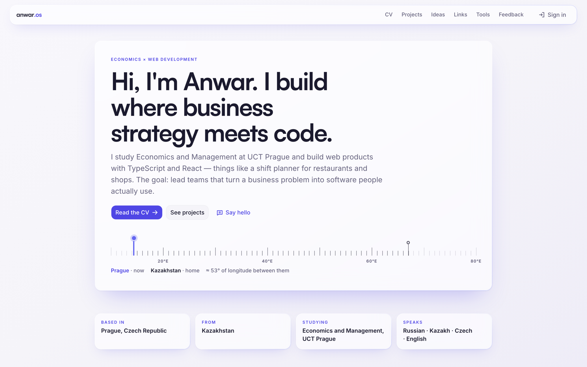
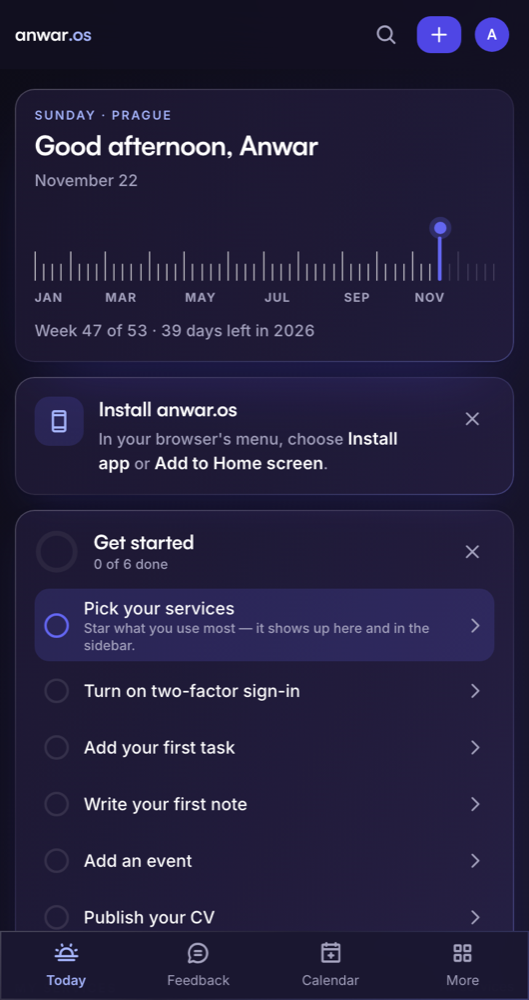
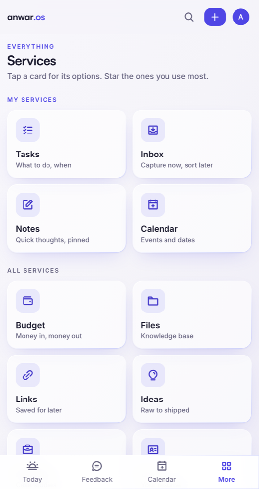
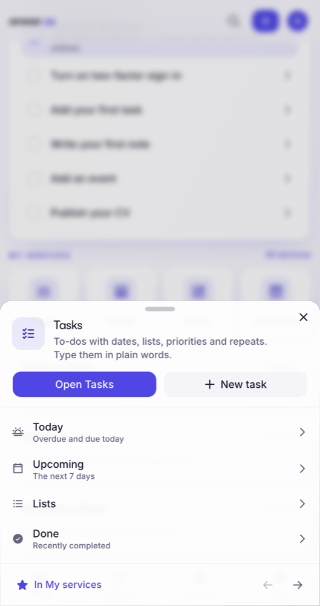
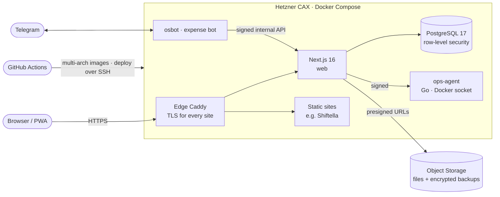

<div align="center">

# anwar.os

**A personal operating system and a public portfolio in one self-hosted app.**

Tasks, notes, calendar, budget, files and ideas for me; a CV, projects, tools and a
feedback form for everyone else. Two Telegram bots, an installable PWA and a control
panel for the server it all runs on.

[**anwar-os.com**](https://anwar-os.com) ·
[Architecture](docs/ARCHITECTURE.md) ·
[Deploy guide](docs/DEPLOY.md) ·
[Conventions](docs/CONVENTIONS.md)

[](https://github.com/NnnotAnwar/anwar-os/actions/workflows/ci.yml)
[](https://github.com/NnnotAnwar/anwar-os/actions/workflows/deploy.yml)
[](https://github.com/NnnotAnwar/anwar-os/actions/workflows/infra.yml)


<picture>
  <source media="(prefers-color-scheme: dark)" srcset="docs/images/site-home-dark.png">
  
</picture>

</div>

## On the phone

The private app is a PWA built phone-first: a tab bar (Today · Feedback · Calendar ·
More), a grid of services with option sheets, safe areas for the iPhone home screen.

<p align="center">
  
  &nbsp;
  
  &nbsp;
  
</p>

## What's inside

**Public site** (`/`): CV, projects with case studies, ideas, saved links, small tools
(calculator, calories, compound interest, statistics) and an anonymous feedback form.
Everything private stays private; what's public is chosen item by item.

**Private app** (`/app`, owner only)

| Module | What it does |
|---|---|
| Today | The day at a glance: calendar, due tasks, reminders and widgets from every module |
| Tasks | Lists, due dates, priorities and repeats, typed in plain words |
| Inbox | Capture now, sort later (also the PWA share target) |
| Notes | Autosaving editor with pinning and search |
| Calendar | Events, recurrence, reminders and an ICS feed |
| Budget | Accounts, categories, plans, goals and recurring payments |
| Files | Knowledge base: folders, uploads to object storage, markdown documents |
| Links, Ideas, Projects, CV | Private by default, publish item by item to the public site |
| Feedback | Complaints and suggestions from the public form, with status |
| Ops | Server control panel: status, logs, restart and deploy of each service |
| Bots | Telegram bot stats and settings |

**Everywhere:** ⌘K palette (jump, search every module, create), light and dark theme,
passkeys and two-factor sign-in, an offline page, and the same UI on desktop and phone.

**Telegram bots** (`bots/`, Python + aiogram)

- **osbot**: forward anything to save it as a task, note, link or idea; `/today`;
  calendar reminders with snooze; new-feedback alerts. Talks to the app only through
  an HMAC-signed internal API.
- **Expense bot**: type `250 coffee`, pick a category, done. Every expense is a Budget
  transaction; day / week / month summaries, history and CSV export.

## Architecture



- **Security first:** the app connects as `os_app`, which can't bypass RLS; every query
  runs as the viewer and every table is owner-scoped (`db/tests` tries to break it).
  Sign-up is closed; the owner signs in with a password plus TOTP, or a passkey.
  Nonce-based CSP, security headers at the edge, rate limits stored in Postgres.
- **Modules** live in `src/modules/<id>/` and plug in through one manifest: routes,
  widgets, search, quick-create and typed actions (also what the bots call).
- **One server, several projects:** a shared edge Caddy owns 80/443; each project joins
  the `edge` network or ships a static build. Nightly `pg_dump` encrypted with `age`
  goes to object storage; restores are drilled.
- **Deploys:** every push to `main` runs CI (unit, DB/RLS, Playwright, bots, Go), builds
  arm64 + amd64 images to GHCR and deploys by commit sha, with automatic rollback when
  the new release fails its health check.

## Stack

Next.js 16 (App Router, Cache Components, React 19.3) · TypeScript · Tailwind CSS 4 ·
shadcn/ui on Base UI · Phosphor icons · PostgreSQL 17 · Drizzle ORM · Better Auth
(TOTP, passkeys, Google link-only) · Vitest · Playwright · Python 3.12 + aiogram 3 ·
Go 1.25 · Docker Compose · Caddy 2.10 · GitHub Actions · Hetzner Cloud + Object Storage

## Repository

```
src/app/            routes: (public) site, (private)/app, api/internal for the bots
src/modules/        one folder per module (manifest, actions, routes, widgets)
src/core/           auth, module system, signed internal APIs
db/                 migrations, init roles, RLS tests
bots/               osbot and the expense bot (Python)
services/ops-agent/ the control panel's Docker agent (Go, stdlib only)
infra/              compose, edge Caddy, bootstrap, deploy, backups
docs/               architecture, deploy guide, conventions
```

## Local development

Requirements: Node 24+, pnpm 10, Docker. Bots need Python 3.12 and uv; the agent needs Go.

```bash
pnpm install
cp .env.example .env.local         # set BETTER_AUTH_SECRET (openssl rand -base64 32)
pnpm db:up                         # Postgres 17 on localhost:55432
pnpm db:migrate
pnpm owner:create you@example.com  # sign-up is disabled; this creates the owner
pnpm dev                           # http://localhost:3000
```

| Command | What it does |
|---|---|
| `pnpm dev` / `pnpm build` | Dev server / production build |
| `pnpm lint` / `pnpm typecheck` | ESLint / route types + `tsc` |
| `pnpm test` | Unit tests (Vitest) |
| `pnpm test:db` | Database, RLS and internal-API tests against local Postgres |
| `pnpm e2e` | Playwright end-to-end suite on a production build |
| `pnpm db:generate` / `pnpm db:migrate` | Create / apply migrations |
| `pnpm owner:create <email>` | Create or promote the owner account |

Deploying to a fresh server, step by step: [docs/DEPLOY.md](docs/DEPLOY.md).
